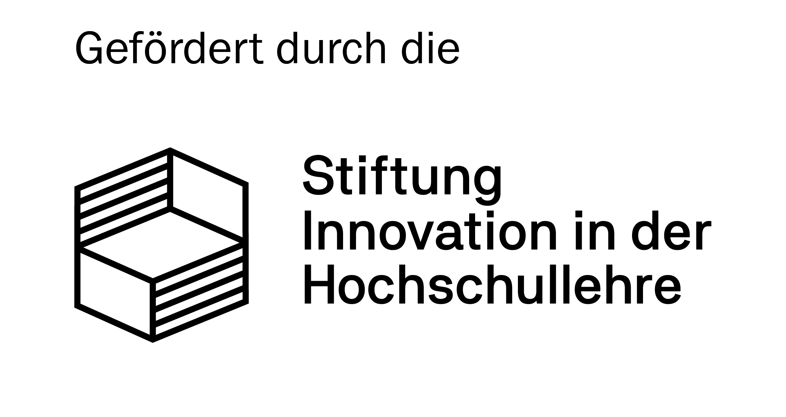

# Qurcuma

A Qt-based GUI for molecular visualization, interactive simulation, and quantum chemistry calculations.



## Features

### 3D Visualization
- **Qt Quick 3D renderer** with Vulkan (auto-fallback to OpenGL)
- Rendering modes: ball-stick, space-filling, wireframe, sticks
- Color schemes: CPK, monochrome, by charge
- Post-processing effects: SSAO, Bloom, HDR, tone mapping, depth fog
- Atom hover highlight, shadows, corner lights
- RMSD overlay (HSV-shifted CPK colors for the second structure)

### Interactive Simulation (MD & Geometry Optimization)
- Backed by [curcuma](https://github.com/conradhuebler/curcuma)'s `SimpleMD` engine
- **Mouse grab**: drag atoms to apply forces during a running MD/Opt
- **Dynamic bonds**: bond topology updated live per frame (hysteresis suppresses flicker)
- **Thermostat selection**: CSVR, Berendsen, Andersen, Nosé-Hoover, None
- **Runtime temperature slider** (color-coded, active during run): drag overrides the current ramp
- Temperature ramps and per-atom temperature regions
- **Confinement walls** (harmonic / LogFermi; sphere or box) with live wireframe visualization
- Iso-potential shells and force-vector field overlay for wall potentials
- Wall violation feedback (recolors wireframe red when atoms leave the box)
- RMSD metadynamics bias (Gaussian flooding to escape local minima)
- **Live charts**: temperature (instant + target) and energy (E_pot / E_kin / E_tot) time series
- Snapshots tab as undo history; auto-snapshot stride configurable
- CLI auto-start: `qurcuma <file> -md` or `qurcuma <file> -opt`

### Structure Editing (Edit Mode)
- Click to select atoms; double-click to select whole molecule (BFS fragment)
- Ctrl/Shift+drag for rubber-band box selection
- Drag to translate; Shift+drag for depth
- WASD/QE scene rotation (full 3-axis) while editing, and in the View and Measure tools with the 3D view focused; Shift+WASD/QE nudges the selection while editing
- Collision detection with clash count and one-click resolve
- Copy / paste / delete atoms (single-frame structures)
- Load and merge molecules from file into the current scene
- Undo via snapshot history

### Analysis
- Distance, angle, and dihedral measurement (auto-detected from selection count)
- RMSD alignment against a reference file with 3D overlay
- Move to origin (mass-weighted centre of mass, Ctrl+Backspace)

### File Formats
- XYZ, VTF (with periodic boundary conditions), PDB, MOL2, CIF (read by curcuma; asymmetric unit or unit cell, SHELX disorder parts, a/b/c repeats, unit cell wireframe, thermal ellipsoids)

### Remote Computing
- **Compute on another machine**: the Simulation dock runs MD and optimisations on a computer reached by ssh; `qurcuma-server` runs there, positions come back over a forwarded WebSocket. The molecule, live temperature and mouse grab work as for a local run
- **Add computer** stores address, port and ssh key file and tests the login, the server and a short session step by step
- **SFTP**: the Project dock browses the files of a saved computer like local ones (needs libssh); the results of a remote run open there
- Needs the Qt WebSockets module at build time; see Requirements

### Assistant and Scripts
- **LLM assistant** (chat dock, [CuteChat](https://github.com/conradhuebler/CuteChat)): talks to any OpenAI-compatible endpoint, local (Ollama, LM Studio, llama.cpp) or hosted with a key from an environment variable. It acts through registered tools, and tool calls that change something go through an approval policy
- **Script dock**: short JavaScript calculations (QJSEngine) with tool calls and a macro recorder

### VR
- Output to an OpenXR headset (View ▸ Show in VR Headset) with controller or hand input; needs Qt 6.8 or newer with Quick3D XR

### Calculation Management
- Launch and manage ORCA, XTB, and Curcuma jobs from one interface
- Organized project directories with automatic calculation history
- Structure and input-file management

### UI
- **Modes Explore / Compute / Teaching** in the menu-bar corner; own layouts are saved as workspaces
- **Looks** (Look ▾ in the viewer bar): colour scheme, material, lighting, effects and background as one named set
- **Appearance dock** (closed by default): style, fragment and bead-type colours; material, lighting and effects under "Advanced"
- **Menus** File · Edit · View · Structure · Simulation · Tools · Help; Help ▸ Keyboard Shortcuts lists the keys of all menu commands
- **Command palette** (Ctrl+K): fuzzy search over all menu actions

## Requirements

- Qt 6 (6.8 or newer recommended) with the modules Quick 3D, Charts, Qml/Quick/QuickWidgets and Shader Tools
- Optional Qt modules, each switching a feature on when found:
  - **WebSockets**: remote computing (`USE_REMOTE`, default ON; without the module it is left out and CMake says so)
  - **Network**: LLM assistant (`USE_LLM`, default ON)
  - **Quick 3D XR** (Qt 6.8 or newer): VR output
- libssh (optional): SFTP file browsing (`USE_SFTP`, default ON; switched off with a notice when libssh is not found)
- C++17 compiler
- Vulkan loader (optional; OpenGL fallback is automatic)
- Fetched by CMake into `external/` on the first configure (needs network, no submodules): [curcuma](https://github.com/conradhuebler/curcuma), [CuteChart](https://github.com/conradhuebler/CuteChart) and [CuteChat](https://github.com/conradhuebler/CuteChat). A checkout already present in `external/` is used as it is; `-DCUTECHAT_DIR=<path>` (or a sibling `../CuteChat`) replaces the CuteChat fetch
- Optional: ORCA, XTB for calculation management

## Build

```bash
git clone https://github.com/conradhuebler/qurcuma.git
cd qurcuma
cmake -B build -DCMAKE_BUILD_TYPE=Release
cmake --build build
```

Debian/Ubuntu packages for the optional parts: `qt6-websockets-dev` (remote computing), `libssh-dev` (SFTP). Options are passed as `-DUSE_REMOTE=OFF`, `-DUSE_SFTP=OFF`, `-DUSE_LLM=OFF`. Changing one in an existing build directory needs the option on the command line once, because the cached value wins over a new default.

## Agentic Coding Disclaimer

This project is developed as an **agentic coding** project using [Claude Code](https://claude.ai/code) with models from [Anthropic](https://www.anthropic.com) and free models provided by [Ollama](https://ollama.com). Large parts of the codebase — including the Qt Quick 3D renderer, interactive simulation integration, structure editing, and UI — were written or substantially shaped by AI coding agents under the supervision of the project author.

## Funding

Development funded in 2026 by **Stiftung Innovation in der Hochschullehre (STIL)**.

## Contributing

Pull requests are welcome.
